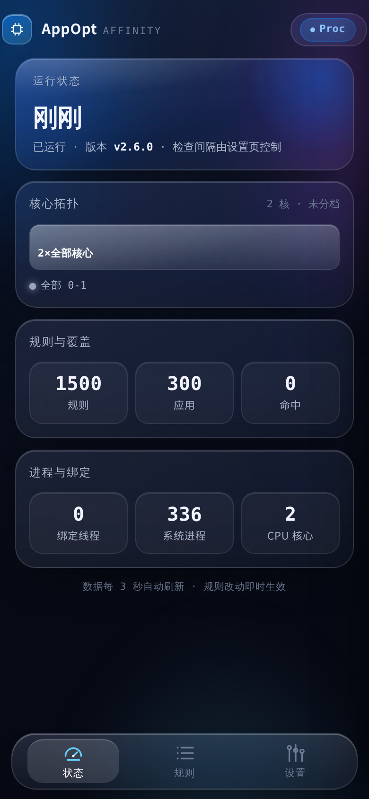
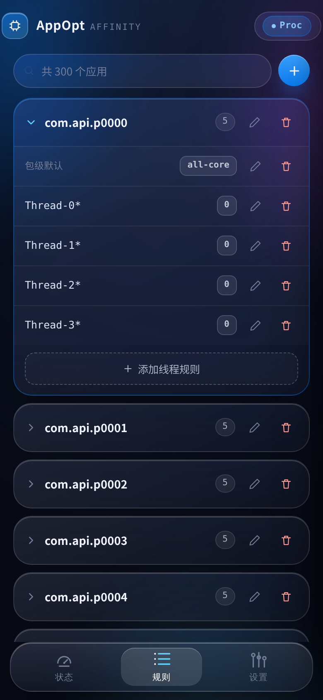

<div align="center">

# AppOpt

**把每一个线程，放到它该在的核上。**

Android 线程亲和性调度器 · Magisk 模块


<sub>规则驱动 · 热加载 · 亚秒级突发接管</sub>

</div>

---

## 它是什么

AppOpt 是一个运行在 Android 上的常驻调度器。它读取一份纯文本规则表，把指定应用的**进程**、**子进程**或**线程**钉在你指定的 CPU 核心上；没有匹配到静态规则的线程，还可以交给**负载动态规则**在运行时自动换核。

没有魔法，只有三件事：

| | |
|---|---|
| **钉住** | 包名、子进程名、线程名（支持 fnmatch 通配）三级规则，落到具体核心或语义核心簇 |
| **看懂** | 从 cpufreq 推断 `e-core / m-core / p-core / hp-core`，规则写「大核」而不是写死 `6-7` |
| **追上** | 500ms 采样 + 双时间尺度 EWMA，突发重负载在 1 秒内被抬到大核 |

---

## 两块面板，一条规则表

```
applist.conf  ──┬─▶  eBPF 事件驱动（内核态过滤，进程创建即绑定）
                │
                └─▶  /proc 轮询（无内核权限时自动回退）
                          │
                          ├─▶  静态规则  →  sched_setaffinity
                          └─▶  动态规则  →  elect / load 决策
```

规则文件由 inotify 监听，保存即生效；面板改规则同样是强制重载，不依赖文件系统时间戳精度。

---

## 规则语法

文件默认 `./applist.conf`，注释用 `#` 或 `//`。

### 包级 / 子进程

```ini
com.example=0-3                 # 编号
com.example=e-core,p-core       # 语义核心
com.example:push=0-3            # 子进程
```

### 线程

```ini
com.example{RenderThread}=hp-core
com.example{RenderThread}=6-7
```

线程名支持 `*`、`?`、`[abc]` 通配；用 `{RenderThread}` 精确指向某条线程。

### 块语法

```ini
com.tencent.mm=e-core,p-core {
    RenderThread=hp-core
    Thread-*=p-core
}
```

块首可带包级规则，块内是线程规则。

### 语义核心

| 名称 | 含义 | 典型来源 |
|---|---|---|
| `e-core` | 能效小核 | 最低频段 |
| `m-core` | 低频中核 | 次低段 |
| `p-core` | 高频中核 | 次高段 |
| `hp-core` | 高性能大核 | 最高频段 |
| `all-core` | 全部核心 | — |

两档芯片自动映射为 `e/h`，三档为 `e/p/h`，四档及以上 `e/m/p/h`。内核不暴露 cpufreq 分档时，拓扑退化为单段「N×全部核心」，规则照样可用。

---

## 动态规则

静态规则回答「它平时该在哪」，动态规则回答「它现在该在哪」。

```ini
Thread-*=elect(hp-core | e-core)       # 组内最忙的线程上大核，其余留小核
Thread-*=elect(6-7 | 0-5)
Thread-*=load(hp-core | p-core | 50)   # 单线程负载超过 50% 就上大核
Thread-*=load(7 | 4-6 | 45)
```

### 判定逻辑

采样周期 **500ms**，每个线程维护两条指数滑动平均：

- `fast`：权重 60%，跟随当前几百毫秒的真实负载
- `slow`：权重 15%，代表这条线程近几秒的基线

两者之差 `fast - slow` 就是**突发分**。

**load（单线程升档）**

- 低档 → 高档：`fast > 阈值 + 5%`，**或者**判定为突发（`fast ≥ 45%` 且突发分 ≥ 25）——突发不需要等阈值也升档
- 高档 → 低档：`fast ≤ 阈值 - 5%`、`slow ≤ 阈值 + 5%` 且突发分 < 12 且已驻留 ≥ 6s，避免快速采样掉坑或突发刚结束就掉档

**elect（组内换人）**

- 常规接力：挑战者领先现任 7% 以上，且现任已驻留 2s
- 突发接管：挑战者 `fast ≥ 70%` 且正在突发，现任驻留满 1s 即可换手
- 空闲让位：现任 `fast ≤ 15%`、挑战者 `fast ≥ 35%` 且领先 20% 以上，驻留满 1s 即可换手，不必等 2s
- 平局按 tid 升序，结果确定可复现

被换下的线程立刻回落到低档核心，不留在高核上占位。

### 内置突发接管（程序级，无需规则）

除了规则驱动的动态调度，程序本身还会主动接管**没有规则覆盖**的高负载线程：只要拓扑里存在
`hp-core` 且它不等于全部核心，内置 governor 就每秒扫描一遍已纳管线程，命中突发就把该线程
抬到大核，冷静后再放回规则结果（规则不再命中则回落全核）。

- 采样：`HOT_PROBE=1000ms`，`fast`(55%) / `slow`(12%) 双 EWMA
- 升档：`fast ≥ 60%` 且（`fast ≥ 75%` 或突发分 `fast - slow ≥ 18`）
- 降档：已升档、驻留 ≥ 2s 且 `fast ≤ 22%`
- 并发上限 6 条线程；每 5s 剪枝一次；采样间隔异常（>3×HOT_PROBE）直接重置 EWMA，避免拿旧窗口算负载
- 升档后每轮再校正一次，防止动态规则把它拉回小核

没有大小核分档的机型（`hp_core` 为空）该路径直接返回，零额外开销。

### 真机数据回推

阈值不是拍出来的，可以在真机上采一轮决策日志再回推。程序内置一个 `APPOPT_TRACE` 开关，
设置后才写文件，不设置时只有一次环境变量查询：

```bash
adb shell su -c 'APPOPT_TRACE=/data/local/tmp/appopt.csv /data/adb/modules/AppOpt/AppOpt -c /data/adb/AppOpt/applist.conf -s 1'
adb pull /data/local/tmp/appopt.csv
python3 tools/trace_report.py appopt.csv
```

CSV 每行一次会改变档位的决策：`ts_ms,src,tid,fast,slow,action`。`src` 为 `hot`（内置接管）/
`dyn`（load 规则）/`dync`（load 候选）/`elec`（elect 换手）。脚本会输出升档延迟 p50/p90、漏检段数、
弱升档次数、每小时换手率，并给出「接下来只动哪一个常量」的建议。日志上限 16 MiB，写满自动停止。

---

## 管理面板

内置一个只监听回环地址的轻量前端，默认 `127.0.0.1:8889`，随主程序编译内嵌，无外部依赖；端口可在设置页「Web 面板」修改，或启动时用 `-p` 指定；KernelSU 的模块入口会读取 `webroot/port.js` 自动跟随当前端口。

- **状态**：运行时长、当前引擎、核心拓扑、规则/覆盖/命中、绑定线程数
- **规则**：搜索、折叠分组、包名与线程名联想、动态规则双档编辑
- **设置**：引擎切换、扫描间隔、CPUSET 目录、规则文件迁移、Web 端口
- **交互**：分组展开与新增线程规则有过渡动画；添加/编辑规则弹层可下滑关闭，返回键/点遮罩也可关闭，删除确认弹层同样支持返回键/遮罩/Esc；左边缘右滑可跟手返回上一页，浏览器返回键同步

```bash
./AppOpt -w
```

> 面板只做本机回环绑定，并校验 `Host` / `Origin` 头；不要把它暴露到公网。

面板针对手机做过渲染优化：极光背景是静态渐变，毛玻璃只出现在 hero、底部 tab 栏和弹层，滚动列表不用 `backdrop-filter`；状态轮询在页面隐藏时暂停，拓扑只有数据变化才重建。容器内无头 Chromium 390×844 空载实测从 100.7% 单核降到 0.8%，视觉仍是原来的液态玻璃样式。

<p align="center">
  
  
</p>

---

## 命令行

| 参数 | 说明 | 默认 |
|---|---|---|
| `-c <file>` | 规则文件路径 | `./applist.conf` |
| `-s <seconds>` | 扫描间隔（≥1） | `2` |
| `-b <name>` | BASE_CPUSET 目录名（不可含 `/`） | `AppOpt` |
| `-w` | 启用 Web 面板 | 关闭 |
| `-p <port>` | Web 面板端口（1024-65535） | 设置值或 8889 |
| `-v` | 版本信息 | — |
| `-h` | 帮助 | — |

---

## 代码结构

```
AppOpt/                 Rust 主程序（lib + bin）
├── src/lib.rs          对外导出与模块边界
├── src/main.rs         入口
├── src/cli.rs          参数解析
├── src/daemon.rs       双模式主循环与节奏控制
├── src/config/         mod · parse · reload
├── src/engine/         mod · cache · proc · ebpf · dynamic
├── src/platform/       mod · cpuset · affinity
├── src/rules/          mod · matcher · editor
└── src/web/            mod · settings
AppOpt-ebpf/            eBPF 内核态（maps + events）
module/                 Magisk 安装脚本与模块文件
```

---

## 构建

### 本机调试

```bash
cd AppOpt
cargo build --release
cargo test
```

### eBPF 内核态

```bash
cd AppOpt-ebpf
export CARGO_TARGET_BPFEL_UNKNOWN_NONE_LINKER="$HOME/.cargo/bin/bpf-linker"
cargo +nightly build --release --target bpfel-unknown-none -Z build-std=core
```

### Android 交叉编译

需要 Android NDK（r27 及以上）。以 `$NDK` 指向解压后的 NDK 根目录：

```bash
export CARGO_TARGET_AARCH64_LINUX_ANDROID_LINKER="$NDK/toolchains/llvm/prebuilt/linux-x86_64/bin/aarch64-linux-android24-clang"
export CARGO_TARGET_X86_64_LINUX_ANDROID_LINKER="$NDK/toolchains/llvm/prebuilt/linux-x86_64/bin/x86_64-linux-android24-clang"

cd AppOpt
cargo build --release --target aarch64-linux-android
cargo build --release --target x86_64-linux-android
```

产物落在 `target/<triple>/release/AppOpt`，随后随模块一起打包。主程序只支持 64 位。

---

## 安装

1. 下载 `modules_update/` 下的模块 zip
2. Magisk / KernelSU 中刷入，重启
3. 编辑 `/data/adb/modules/AppOpt/applist.conf`，保存即生效
4. 需要面板时，在模块脚本里启用 `-w`，手机浏览器打开 `http://127.0.0.1:8889`（端口可在设置页改）

---

## 已知边界

- eBPF 模式需要内核支持与相应权限，不可用时自动回退 `/proc` 轮询
- 部分内核不暴露 cpufreq 分档，语义核心会退化为 `all-core`
- 面板无鉴权，仅限本机使用
- 删除线程规则不会回收已存在的绑定，重启或重新匹配后清除

---

<div align="center">
<sub>AppOpt · 规则写给机器，调度留给运行时</sub>
</div>
